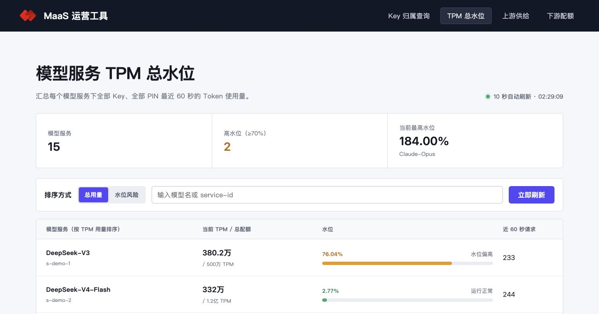

# Key PIN Lookup

**面向 MaaS 运营的归属查询与容量水位演示工具。**

围绕“定位调用主体 → 查看模型水位 → 识别额度压力”组织运营信息。本仓库可使用 Mock 数据独立运行；公开展示不包含企业访问 Token、数据库凭据或真实客户记录。



## 快速浏览

- [产品案例与设计取舍](docs/showcase/product-case.md)
- [三分钟演示与运行方式](docs/showcase/demo.md)
- [数据源与配置说明](docs/integration.md)
- [验证记录](docs/showcase/verification.md)

## 展示能力

| 模块 | 说明 |
| --- | --- |
| Key 归属查询 | 根据演示 API Key 或 Key ID 定位 PIN，区分 Key 使用人与 PIN 归属人 |
| TPM 总水位 | 模型维度用量、容量和使用率的集中展示 |
| 下游监控 | 将租户、模型、峰值用量与配额关联分析 |
| 数据源边界 | Mock 为本地演示；真实适配器需要用户自己的授权配置 |

## 本地演示

建议 Node.js 22+、pnpm 11+。在仓库根目录执行：

```bash
cp .env.example .env
pnpm install --frozen-lockfile
pnpm build
pnpm start
```

访问 `http://127.0.0.1:8080`。公开示例配置使用 `MOCK_MODE=true`、`AUTH_MODE=none`，仅适用于本地合成数据演示。查询可输入 `key-demo-zjpt888` 或 `pk-demo-zjpt888`。

真实数据模式的监控接口保持停用；本次仅开放 Mock 样例。归属查询接入真实数据需显式设置自己的服务地址、只读权限和访问控制。示例中的 `ops.example.com` 为占位域名；演示模式不连接它。

## 与简历项目的关系

本仓库用于展示 MaaS 运营查询与部分水位监控能力。它不等同于简历中全局 AI Gateway 监控平台的完整实现，也不覆盖全部 RPM、错误率或供应商下钻功能。实习业务指标与本地演示数据分开陈述。
