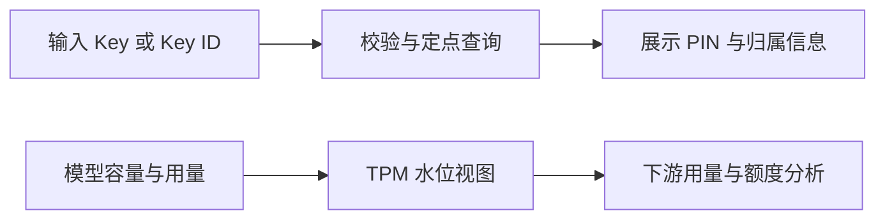
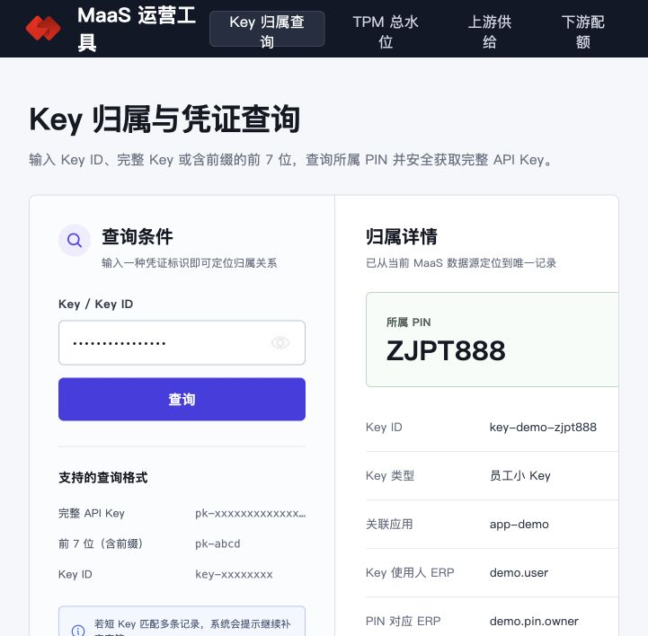
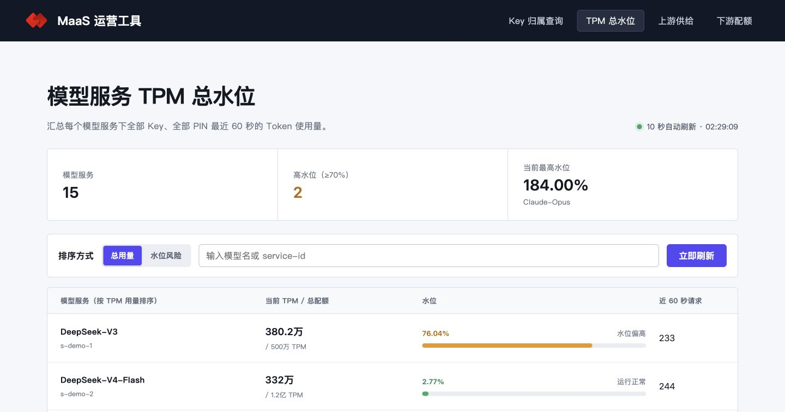

# MaaS 运营查询与监控产品案例

## 业务背景与目标

运营排查模型服务问题时，需要将调用密钥、租户归属、模型容量和用量关联起来。信息散落在不同表与查询中，会增加重复查询和误读归属的成本。

产品将归属查询与水位观察集中到同一工具：快速回答“这次调用属于谁”“哪个模型接近容量边界”“哪些租户需要继续排查”。

## 产品设计

### 归属信息必须可解释

分别展示 Key 使用人和 PIN 对应归属人。缺少权威映射时直接说明不支持，不使用 Key 使用人推测 PIN 归属。

### 水位需要同时展示用量与容量

单独展示 Token 数不便判断压力。将观察窗口、容量上限、当前用量与使用率放在一起，帮助运营继续定位问题。

### 慢分析与即时查询分开

下游监控涉及较长时间范围的聚合，因此采用分片读取、成功结果缓存和后台刷新。归属查询只进行定点检索，不通过全表扫描换取“看似快速”的结果。

## 演示范围

截图和公开演示使用合成数据。该工具只展示已实现的运营查询和部分容量监控；不能据此宣称完整复现简历中的生产监控平台。

## 如何验证

见 [演示步骤](demo.md) 与 [验证记录](verification.md)。业务成果来自实际实习工作，本仓库的示例数量和用量不作为实习成效数据。
